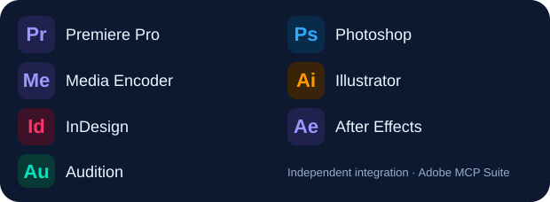

# Adobe MCP Suite

<p align="center">
  
  
</p>

Seven independent [Model Context Protocol](https://modelcontextprotocol.io/) servers for Adobe creative applications. Each server has its own tool catalog, authenticated loopback bridge, and CEP panel. Connect only the applications you need.

Built with JavaScript and the official MCP SDK. No API key or cloud backend is required.

Start with the [documentation index](docs/README.md), [installation guide](docs/INSTALLATION.md), [terminal command reference](docs/CLI.md), [MCP configuration](docs/CONFIGURATION.md), and [troubleshooting](docs/TROUBLESHOOTING.md).

**Status:** early development. Protocol, transport, validation, and simulated host tests are available. Native workflows have **not yet been verified inside Adobe applications**. This release uses CEP/ExtendScript; a UXP adapter is not included.

## Applications and tools

| Application   | Server entrypoint               | Default port | Default tools | Main workflows                                                                  |
| ------------- | ------------------------------- | ------------ | ------------- | ------------------------------------------------------------------------------- |
| Premiere Pro  | `src/servers/premiere-pro.mjs`  | 19101        | 20            | Sequence settings, ranges, clip enablement, media relinking, markers and export |
| Photoshop     | `src/servers/photoshop.mjs`     | 19102        | 20            | Documents, layer/text editing, duplication, cropping, resizing and image export |
| Media Encoder | `src/servers/media-encoder.mjs` | 19103        | 15            | Source metadata, media/image/stitch queues, previews and batch controls         |
| Illustrator   | `src/servers/illustrator.mjs`   | 19104        | 21            | Selection, layers, artboards, shapes, linked images and AI/SVG/PNG/PDF output   |
| InDesign      | `src/servers/indesign.mjs`      | 19105        | 19            | Documents, pages, text frames, linked assets and INDD/PDF/IDML output           |
| After Effects | `src/servers/after-effects.mjs` | 19106        | 25            | Compositions, layer timing, effects, keyframes, markers and render templates    |
| Audition      | `src/servers/audition.mjs`      | 19107        | 11            | Command batches, API discovery, waveform information and relative navigation    |

**131 tools are enabled by default.** Every server includes `connection_status` and `get_app_info`. Enabling the optional `run_script` adds one tool per server.

Every server also provides two MCP resources for its catalog and workflow guide, and two prompts for workflow planning and connection diagnosis. These discovery features work without an Adobe connection and do not execute native operations.

See the [tool catalog](docs/TOOLS.md), [input schemas](docs/tools.json), [MCP resources and prompts](docs/MCP-DISCOVERY.md), and [architecture notes](docs/ARCHITECTURE.md).

## Requirements

- A matching [portable release](https://github.com/salehghotbani/adobe-mcp-suite/releases/latest), including Node.js and production dependencies. Source development requires Node.js 22+ and npm.
- An Adobe application that supports CEP 10 or newer and the relevant ExtendScript APIs.
- An MCP client supporting local stdio servers.
- Windows x64 or macOS Intel/Apple Silicon for native panels. Linux x64/ARM64 supports server-only installation and protocol discovery; native Adobe desktop hosts are unavailable on Linux.

Adobe is transitioning extensions to UXP. Check [Adobe's migration guidance](https://helpx.adobe.com/au/creative-cloud/apps/integration-with-other-apps/manage-plugins/cep-uxp-plugin-transition.html) and your installed application's extension support. The broad host version range in the generated manifests is a loading rule, not a compatibility certification.

## Terminal installer

Download the matching ZIP from [Releases](https://github.com/salehghotbani/adobe-mcp-suite/releases/latest), verify its SHA-256 checksum with `SHA256SUMS`, and extract it. No global Node.js/npm installation is required.

```powershell
# Windows: inside the extracted bundle
.\adobe-mcp.cmd install --apps premiere,photoshop --enable-unsigned
```

```sh
# macOS: inside the extracted bundle
chmod +x ./adobe-mcp ./runtime/node
./adobe-mcp install --apps ps,ai --enable-unsigned
```

```sh
# Linux: inside the extracted bundle; native Adobe hosts are unavailable
chmod +x ./adobe-mcp ./runtime/node
./adobe-mcp install --apps ps,ai --server-only
```

Omit `--apps` for an interactive selection, or use `--apps all`. The installer prints the stable launcher path and the MCP client configuration file. Add the reported `bin` directory to PATH and import `mcp-servers.json` into your MCP client. On Windows/macOS, restart Adobe and open the selected CEP panels. The explicit `--enable-unsigned` option enables current-user development panel loading. Each ZIP contains shared server code; app selection determines the generated server entries and installed panels.

```sh
adobe-mcp install --apps ae,au    # Add tool sets; preserve existing selections
adobe-mcp config                 # Print selected MCP client entries
adobe-mcp doctor                 # Verify installation files and settings
adobe-mcp updates check
adobe-mcp update
adobe-mcp rollback
adobe-mcp uninstall --apps ps
```

Automatic update checks run in the background while a managed MCP server is running, using a shared 24-hour cache. They notify through stderr; `update` installs a release explicitly after checksum and bundle verification. Selections and bridge tokens survive updates. Use `adobe-mcp updates off` to disable checks, or `updates interval --hours 48` to change the interval.

See the complete [installation, platform, update and rollback guide](docs/INSTALLATION.md) for bootstrap scripts, custom locations, offline use, backups, retained runtimes and unsigned panel settings. Release assets include five portable ZIPs, optional PowerShell/POSIX bootstrap installers, source/npm packaging, checksums and license notices.

## Source checkout on Windows (development)

This workflow runs servers directly from the checkout and uses `.adobe-mcp/config.json`. The terminal manager uses its own installation home and `connections.json`; see [configuration modes](docs/CONFIGURATION.md#managed-installation-and-source-checkout). Use the installer that owns your panels. Keep development panels separate from managed installations.

### 1. Install dependencies and prepare the panels

```powershell
git clone https://github.com/salehghotbani/adobe-mcp-suite.git
cd adobe-mcp-suite
npm ci
npm run setup
```

In PowerShell environments that block `npm.ps1`, use `npm.cmd` in place of `npm`.

Setup generates:

- `build/cep/`: seven application-specific CEP panels.
- `.adobe-mcp/config.json`: local ports and randomly generated bridge tokens.
- `.adobe-mcp/mcp-servers.json`: MCP client configuration with absolute paths.

Repeated setup preserves existing tokens. Run it again after moving the checkout to update absolute paths. Generated configuration and panels are ignored by Git because they contain local credentials.

### 2. Install the CEP panels

```powershell
powershell -NoProfile -ExecutionPolicy Bypass -File .\scripts\install-cep.ps1 -EnableUnsigned
```

The installer copies the panels into `%APPDATA%\Adobe\CEP\extensions`. The explicit `-EnableUnsigned` option sets `PlayerDebugMode=1` under the current user's `HKCU\Software\Adobe\CSXS.10`, `CSXS.11`, and `CSXS.12` keys so unsigned development panels can load. Omit the option to leave those settings unchanged. Administrator privileges are not required.

Install only one application with `-App photoshop`, or use any application ID from the entrypoint table. To update an existing installation, use `-Force`; the installer backs up the previous panel beside its installation directory.

### 3. Connect your MCP client

1. Restart the Adobe application.
2. Open **Window > Extensions** or **Extensions (Legacy) > Adobe MCP — Application Name** and keep the panel open.
3. Copy the desired server entries from `.adobe-mcp/mcp-servers.json` into your MCP client's configuration.
4. Reconnect the client and call `connection_status`. A `connected: true` result confirms the matching panel is polling the bridge.

The MCP client starts each server. Manual `npm run start:photoshop` and other `start:*` commands are useful for development, but do not run a second copy of the same server on its existing port.

## Example tool inputs

Create a Photoshop document with `create_document`:

```json
{
  "name": "Poster",
  "width": 1920,
  "height": 1080,
  "resolution": 72
}
```

Export the active Photoshop document with `export_image`:

```json
{
  "path": "C:\\Exports\\poster.png",
  "format": "png",
  "overwrite": false
}
```

Output directories must already exist. File paths must be absolute and local. Save-as and export tools refuse existing files unless `overwrite: true` is supplied; save-in-place tools intentionally save the current file. Tool descriptions specify units and whether indexes start at zero or one. Most editing tools operate on the active document or sequence.

Unicode parameters are preserved. Text rendering, fonts, shaping, and writing direction still depend on the host document settings.

## Configuration

Managed installations load `<installation home>/connections.json` and export `<installation home>/mcp-servers.json`. Direct source servers default to `<checkout>/.adobe-mcp/config.json`. Managed `run` explicitly selects its home's connection file. See the [configuration guide](docs/CONFIGURATION.md) for complete precedence rules and copyable MCP client entries.

Set these environment variables on an individual MCP server entry:

| Variable                    | Purpose                                                                                                    |
| --------------------------- | ---------------------------------------------------------------------------------------------------------- |
| `ADOBE_MCP_CONFIG`          | Alternative connection file for direct source servers; managed `run` selects its own home                  |
| `ADOBE_MCP_PORT`            | Override the server's loopback port                                                                        |
| `ADOBE_MCP_TOKEN`           | Override its bridge token; 32–1024 visible ASCII characters                                                |
| `ADOBE_MCP_TIMEOUT_MS`      | Operation deadline; defaults to `60000`, allowed range `100`–`3600000`                                     |
| `ADOBE_MCP_ALLOW_SCRIPTS`   | Set exactly `true` to expose `run_script` with full ExtendScript permissions                               |
| `ADOBE_MCP_NO_UPDATE_CHECK` | Set exactly `1` to suppress background checks in a managed server                                          |
| `ADOBE_MCP_HOME`            | Installation home for CLI invocation; `--root` takes precedence; installed launchers select their own home |

For long operations, increase both the server deadline and your MCP client's tool timeout. To change a saved port or token, stop the affected server and panel, edit the connection file for the workflow you use, then regenerate matching panels. Managed installations use `adobe-mcp install --apps <app>`; source checkouts use setup and panel reinstallation. Follow the [port and token change procedure](docs/CONFIGURATION.md#change-a-saved-port-or-rotate-a-token). Server environment overrides must match the panel's settings.

## Connection and execution behavior

```text
MCP client -- stdio --> application-specific MCP server
                                 |
                    HTTP + token on 127.0.0.1
                                 |
                          matching CEP panel
                                 |
                             evalScript
                                 |
                         Adobe ExtendScript DOM
```

Each bridge accepts only its application's host ID and panel lease. Commands execute serially. The panel can retry result delivery without repeating native execution. Logs go to stderr so stdout remains an MCP protocol channel.

A queued operation that times out before dispatch is removed without execution. If a deadline expires after dispatch, Adobe may still be working; the bridge blocks additional dispatch until the outstanding result arrives. Inspect Adobe before retrying a modifying operation. If no result arrives, inspect the application and then restart the server and panel. Multi-step native edits do not provide a global transaction and may leave partial changes on failure.

The bridge binds only to `127.0.0.1`, authenticates operational requests, and rejects web origins. Local credentials do not isolate the bridge from other software running under the same user account. Read the [security policy](SECURITY.md) before exposing arbitrary scripting or using sensitive documents.

## Application limitations

- **Audition:** APIs vary by version. Discover actual command IDs with `list_commands`, check them with `is_command_enabled`, and invoke them with `invoke_command`. Some commands open native dialogs. Playhead tools support waveform documents, not multitrack sessions.
- **Media Encoder:** queue acceptance does not mean encoding completed. Batch state does not establish that every output succeeded.
- **After Effects:** render templates are installed and localized by the host. Inspect resolved output paths and existing queue items before rendering.
- **All applications:** codecs, fonts, presets, dialogs, and scripting preferences depend on the installed version. Verify workflows with disposable documents before using production projects.

## Development and verification

```sh
npm ci
npm run check
npm test
npm run catalog
npm run catalog:check
```

`check` verifies consistent formatting, validates JavaScript syntax, checks for duplicate tool names, and parses every generated host script as ES3. Use `npm run format` to format source files. `catalog:check` verifies generated documentation without modifying files. Tests cover real MCP stdio connections for all seven servers, catalog isolation, schemas, configuration validation, repeatable panel setup, authenticated HTTP transport, queue ordering, deadlines, Unicode, file checks, and the actual panel code running against a simulated Adobe host. Loopback HTTP must be allowed by the test environment.

GitHub Actions runs the checks on Windows, macOS and Linux with Node.js 22 and 24. Release bundles also pass native-runner installation and MCP stdio smoke tests on all five targets. These checks do not replace native Adobe integration testing.

Read [CONTRIBUTING.md](CONTRIBUTING.md) for the workflow and validation expectations. The [changelog](CHANGELOG.md) records release changes.

## Project layout

```text
src/
  apps/        Application-specific tool catalogs and host scripts
  bridge/      Authenticated HTTP transport and ExtendScript serialization
  catalog/     Generated documentation model
  cli/         Terminal command parsing and application selection
  config/      Application metadata, project paths, version, and settings
  installer/   Managed installation, bundles, updates and rollback
  mcp/         MCP registration, common tools, and input schemas
  servers/     Seven stable executable entrypoints
  setup/       Repeatable panel and client-configuration generation
cep/           Panel HTML, CSS, JavaScript, and manifest template
bin/           Public terminal executable
scripts/       Development and installation commands
tests/
  unit/        Configuration, catalog, and host-script checks
  integration/ MCP, bridge, panel, and setup workflows
  helpers/     Disposable test fixtures
  windows/     PowerShell bootstrap regression test
assets/branding/ Active icon, design prompt, and archived designs
docs/          Installation, CLI, configuration, troubleshooting and tool reference
```

`build/` and `.adobe-mcp/` contain generated development panels and local configuration. Release packaging uses ignored `dist/` and `.release-build/` directories. The source layout preserves the server entrypoints used by existing MCP client configurations.

## Project icon

The [project icon](assets/branding/adobe-mcp-icon.png) uses a sapphire pen nib, cyan edges, and seven connection nodes on a navy tile. It is included in all generated panels. The [design prompt](assets/branding/blue-pen-prompt.txt) and earlier design files are retained in `assets/branding/`.

Beside the icon, the [application badges](assets/branding/applications.svg) identify all seven programs by symbol and name: **Pr — Premiere Pro**, **Ps — Photoshop**, **Me — Media Encoder**, **Ai — Illustrator**, **Id — InDesign**, **Ae — After Effects**, and **Au — Audition**. These independently drawn letter badges identify applications; they do not certify Adobe version compatibility.

## License and attribution

Project source is distributed under the [MIT License](LICENSE). Third-party dependencies retain their own licenses; see [NOTICE](NOTICE). Adobe product names and trademarks belong to Adobe. This is an independent project and is not affiliated with or endorsed by Adobe.
